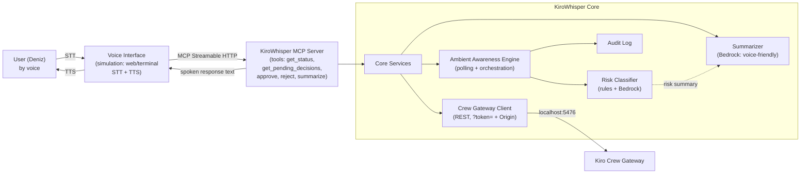

# Design — KiroWhisper

## Overview

KiroWhisper is a layer for overseeing the autonomous **Kiro Crew** by voice. Its
core is an **MCP server** (spec 2025-11-25, Streamable HTTP); on one side a voice
interface (Alexa+ or simulation) connects as an MCP client, on the other side
KiroWhisper calls the **Kiro Crew Gateway REST API**. The distinguishing
capability is **Ambient Awareness**: a background engine that continuously
watches approval requests, classifies them by risk, and filters them.

This design is grounded in the real Crew API behavior verified live in the spike
(see the private working notes -> "Crew Spike Results"). No invented endpoints.

## High-level architecture



**Separation:** the MCP server is the outer face (voice side). Core services are
the intelligence. The Gateway client is the bridge to Crew. The Ambient Awareness
engine is the always-running brain. This separation preserves the principle
"the transport (voice/Crew) may change, but the intelligence stays with us."

## Components and responsibilities

### 1. Crew Gateway Client (`gateway_client`)
A thin, single-responsibility layer wrapping the Crew Gateway REST. **Real
endpoints verified in the spike:**
- Auth: `kirocrew token` -> JWT; every request carries `?token=<JWT>` query param
  + `Origin: http://localhost:5476` header (REQUIRED — `deny_non_dashboard_caller`).
- `get_status()` -> `GET /api/status`
- `list_pending_approvals()` -> `GET /api/approvals` -> `[{id, source, tool,
  tool_input, tool_purpose, slot, ts}]`
- `get_slot(slot)` -> `GET /api/chat/slots/<slot>` (permission messages + meta)
- `resolve(slot, request_id, action)` -> `POST /api/chat/slots/<slot>/approve`
  body `{"action": action, "request_id": request_id}`
  - action in {`"approved"`, `"rejected"`, `"trust"`}  ⚠️ "approved" (past tense!)
- `send_message(slot, msg)` -> `POST /api/chat` (redirect/clarify; fire-and-forget)
- `spawn(task)` / `get_task_result(id)` -> `POST/GET /api/spawn[/id]` (status loop)

**Design decisions:**
- Direct REST via `httpx` — the in-repo `kirocrew-client` uses cookie auth and
  DOES NOT WORK; we write our own thin client with `?token=`+Origin.
- Token refresh: tokens expire (observed in spike); the client re-runs
  `kirocrew token` when needed (or app-secret exchange — v2).

### 2. Ambient Awareness Engine (`ambient`)
The heart of the project. A continuously running async loop:
```
loop (every N seconds):
  pending = gateway.list_pending_approvals()
  for approval in newly seen:
     risk = risk_classifier.classify(approval)
     decision = policy.decide(risk, session_trust)
     if decision == AUTO_APPROVE:  gateway.resolve(slot, id, "approved"); audit(...)
     elif decision == AUTO_BLOCK:  gateway.resolve(slot, id, "rejected"); audit(...)
     else (SURFACE):               queue_for_user(approval, risk); notify_proactive()
```
- **Idempotent:** each approval `id` is processed once (remembers seen ids).
- **Conservative:** `policy.decide` always SURFACEs on UNKNOWN or HIGH (R3.3).
- **Fail-safe:** if the Gateway is unreachable, nothing is auto-passed (R1.4).

### 3. Risk Classifier (`risk`)
Assigns an approval to LOW / HIGH / UNKNOWN. **Two layers:**
- **(a) Deterministic rules (fast, reliable, runs first):**
  - `is_read_only` truthy -> LOW
  - `is_shell` truthy -> at least HIGH
  - destructive pattern in `tool_input`/diff (`rm -rf`, `DROP TABLE`, `force`,
    `.env`/secret path, broad deletion) -> HIGH
  - if unclear -> defer to (b)
- **(b) Bedrock classification (nuanced):** raw tool + purpose + diff -> Bedrock
  asked "is this reversible? dangerous? why?" -> structured risk + reason. If
  Bedrock is unsure or errors -> UNKNOWN (never fall to LOW).
- **Output:** `RiskAssessment{level, reason, spoken_summary}` — spoken_summary
  feeds the Summarizer.
- Rule: **rules override Bedrock in the safe direction** (if a rule says HIGH,
  it stays HIGH even if Bedrock says LOW). Safety tightens one way only.

### 4. Summarizer (`summarizer`)
Uses Bedrock to reduce raw data (diff/log/status) into **voice-friendly** text:
- Approval summary: "42 lines being deleted in auth.js, cannot be undone."
- Status summary: "2 of 3 tasks done, one is waiting for you."
- Ambient summary: "I passed 19, blocked 3, and 1 is waiting for you."
- Constraint (NFR-3): short, priority-ordered, not raw diff; at most 2-3 options.

### 5. MCP Server (`mcp_server`)
Exposes the core as MCP tools (R12; genuinely invoked at runtime):
| Tool | What it does | Calls |
|---|---|---|
| `get_status` | overall status + ambient summary (passed/blocked/waiting) | gateway + ambient |
| `get_pending_decisions` | voice-lists surfaced requests | ambient queue |
| `approve` | approves a request (returns double-confirm info if HIGH) | gateway.resolve(approved) |
| `reject` | rejects + sub-option (skip/pause/cancel) handling | gateway.resolve(rejected)/pause |
| `trust_session` | session trust (auto-approve low risk) | gateway.resolve(trust) |
| `summarize` | voice-friendly summary of a task/diff | summarizer |
- Transport: **Streamable HTTP** (Alexa+ requirement). Framework: official MCP Python SDK.

### 6. Voice Interface (`voice_sim`) — simulation
A rules-compliant simulated Alexa+ (R11). The backend is entirely real; only the
Alexa+ layer is simulated:
- **Primary:** web-based (microphone -> STT -> MCP -> TTS). The user's own voice.
- STT/TTS: prefer low-latency (NFR-2). No ElevenLabs (realism + latency).
- Proactive (R7): when the ambient engine produces a SURFACE, the interface
  triggers a spoken alert (polling -> alert). Staging on a real Echo is an
  optional bonus (Kay bridge).

### 7. Audit (`audit`)
Every decision (approve/reject/auto-pass/auto-block) -> timestamp, id, risk,
decision, reason. Local append-only log. The source of the "I blocked 3 dangerous
operations today" summary.

## Main data flows

### Flow A — "What's Kiro up to?" (PULL, R4)
```
voice "what's up?" -> STT -> MCP get_status
  -> ambient.snapshot() (how many SURFACE/AUTO/BLOCK) + gateway.get_status()
  -> summarizer(Bedrock) -> voice-friendly text -> TTS -> user
```

### Flow B — Ambient filter + proactive approval (R1,2,3,5,7) — THE HEART
```
[background] ambient loop:
  gateway.list_pending_approvals() -> new approval
  risk.classify() [rules -> Bedrock if needed]
  policy.decide():
    LOW+trust  -> gateway.resolve("approved") + audit   (silent)
    explicit-deny -> gateway.resolve("rejected") + audit (silent)
    HIGH/UNKNOWN -> queue + proactive alert
[user] "what's up?" -> get_pending_decisions -> summary ("auth.js delete, irreversible")
  -> "approve" -> if HIGH, double-confirm -> approve tool -> gateway.resolve("approved")
```

### Flow C — Rejection sub-options (R6)
```
"no" -> "I didn't do it" + [skip/pause/cancel]
  skip   -> gateway.resolve("rejected")
  pause  -> do not resolve + hold task (send no new message); timeout -> pause
  cancel -> extra confirm -> stop task
```

## Technical decisions (fixed)
- **Language:** Python 3.12 (compatible with the Crew ecosystem; note: the machine
  has 3.14 which the spike venv used — the product targets 3.12 with a pinned venv).
- **MCP:** official MCP Python SDK, Streamable HTTP.
- **LLM:** Amazon Bedrock (AWS Builder mini-challenge). Model: Nova Lite first
  (cheap/fast, us-east-1), Claude if needed (nuanced risk). Region **us-east-1**.
- **Async:** asyncio (polling loop + MCP + REST together).
- **Auth:** `?token=` (kirocrew token) + Origin header.
- **Structure (proposed):**
  ```
  src/kirowhisper/
    gateway_client.py   # Crew REST (derived from the spike)
    ambient.py          # polling + orchestration
    risk.py             # rules + Bedrock classification
    summarizer.py       # Bedrock voice-friendly summary
    audit.py
    mcp_server.py       # MCP tools
    voice_sim/          # web-based voice simulation (STT+TTS)
  ```

## Data models
```
Approval:        { request_id, slot, tool_title, purpose, diff, is_read_only, is_shell, ts }
RiskAssessment:  { level: LOW|HIGH|UNKNOWN, reason, spoken_summary }
Decision:        { approval_id, action: AUTO_APPROVE|AUTO_BLOCK|SURFACE, risk, ts }
PendingDecision: { approval, risk, surfaced_at }        # user queue
AuditEntry:      { ts, approval_id, risk, action, reason, by: system|user }
```

## Errors / edge cases
- Gateway down -> retry, NO auto-approve (R1.4).
- Bedrock error/timeout -> risk UNKNOWN -> SURFACE (fail-safe).
- Timeout without approval -> Crew "deny on silence" (~60-75s); ambient knows this
  and tells the user "it timed out and was rejected to be safe."
- STT ambiguous + HIGH risk -> do not approve, re-ask (R5.5).
- Stale/duplicate approval id -> idempotent guard (take the latest permission message).

## Security (NFR-1)
- Safe default at every layer: classification UNKNOWN->SURFACE, rules tighten one
  way, Gateway/Bedrock errors -> SURFACE.
- Destructive operations only via explicit user approval or explicit deny rule.
- Secrets/tokens masked in responses; raw secrets never written to the audit log.

## Test / verification strategy
- Risk classifier: unit tests over known dangerous/safe diff samples (the rule
  layer is deterministic and testable).
- Ambient engine: three-bucket decision tests against a fake Gateway.
- E2E: the productized version of the spike scripts — real Crew task -> filter -> approve.
- Demo rehearsal: the breakfast scenario on a real Echo/simulation.

## Open design questions (to resolve before tasks)
1. Ambient poll interval? (proposed: 2-3s; deny-timeout ~60s leaves ample margin.)
2. How often does risk classification call Bedrock? (proposed: only when rules say
   "unclear" -> low cost/latency.)
3. Simulation interface web or terminal? (proposed: web — demo visuals + rich card path.)
4. "Pause" (R6.4) is not native: is not-resolving-and-holding enough, or an
   explicit pause message to the slot? (to be resolved in tasks via spike.)
