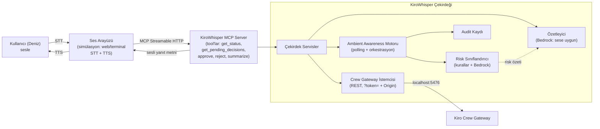

# Design — KiroWhisper

## Overview

KiroWhisper, otonom **Kiro Crew**'i sesle denetleyen bir katmandır. Çekirdeği bir
**MCP server**'dır (spec 2025-11-25, Streamable HTTP); bir tarafta sesli arayüz
(Alexa+ veya simülasyon) MCP client olarak bağlanır, diğer tarafta KiroWhisper
**Kiro Crew Gateway REST API**'sini çağırır. Ayırt edici yetenek **Ambient
Awareness**: onay taleplerini sürekli izleyen, risk sınıflandıran ve filtreleyen
bir arka plan motoru.

Bu tasarım, `spike/`'ta canlı doğrulanan gerçek Crew API davranışına dayanır
(bkz. `docs/PROJECT_NOTES.md` → "CREW SPIKE SONUÇLARI"). Uydurma uç yoktur.

## Mimari (yüksek seviye)



**Ayrım:** MCP server = dış yüz (ses tarafı). Çekirdek servisler = zeka. Gateway
istemcisi = Crew'e köprü. Ambient Awareness motoru = arka planda sürekli çalışan
beyin. Bu ayrım, "transport (ses/Crew) değişse bile zeka bizde kalır" ilkesini korur.

## Bileşenler ve sorumluluklar

### 1. Crew Gateway İstemcisi (`gateway_client`)
Crew Gateway REST'ini saran ince, tek sorumlu katman. **Spike'ta doğrulanan
gerçek uçlar:**
- Auth: `kirocrew token` → JWT; her istekte `?token=<JWT>` query param + `Origin:
  http://localhost:5476` header (ZORUNLU — `deny_non_dashboard_caller`).
- `get_status()` → `GET /api/status`
- `list_pending_approvals()` → `GET /api/approvals` → `[{id, source, tool,
  tool_input, tool_purpose, slot, ts}]`
- `get_slot(slot)` → `GET /api/chat/slots/<slot>` (permission mesajları + meta)
- `resolve(slot, request_id, action)` → `POST /api/chat/slots/<slot>/approve`
  gövde `{"action": action, "request_id": request_id}`
  - action ∈ {`"approved"`, `"rejected"`, `"trust"`}  ⚠️ "approved" (geçmiş zaman!)
- `send_message(slot, msg)` → `POST /api/chat` (redirect/clarify; ateşle-bekleme)
- `spawn(task)` / `get_task_result(id)` → `POST/GET /api/spawn[/id]` (durum döngüsü)

**Tasarım kararları:**
- Doğrudan `urllib`/`httpx` ile REST — repo-içi `kirocrew-client` cookie auth
  kullandığı için ÇALIŞMIYOR; biz `?token=`+Origin ile kendi ince istemcimizi yazarız.
- Token yenileme: token süreli (spike'ta ~exp gördük); istemci gerektiğinde
  `kirocrew token`'ı yeniden çağırır (veya app-secret exchange — v2).

### 2. Ambient Awareness Motoru (`ambient`)
Projenin kalbi. Arka planda sürekli çalışan asenkron döngü:
```
loop (her N saniye):
  pending = gateway.list_pending_approvals()
  for approval in pending yeni olanlar:
     risk = risk_classifier.classify(approval)
     decision = policy.decide(risk, session_trust)
     if decision == AUTO_APPROVE:  gateway.resolve(slot, id, "approved"); audit(...)
     elif decision == AUTO_BLOCK:  gateway.resolve(slot, id, "rejected"); audit(...)
     else (SURFACE):               queue_for_user(approval, risk); notify_proactive()
```
- **Idempotent:** her approval `id` bir kez işlenir (görülenleri hatırlar).
- **Muhafazakâr:** `policy.decide` UNKNOWN veya HIGH'da her zaman SURFACE (R3.3).
- **Fail-safe:** Gateway erişilemezse hiçbir şey otomatik geçmez (R1.4).

### 3. Risk Sınıflandırıcı (`risk`)
Bir onay talebini LOW / HIGH / UNKNOWN'a atar. **İki katman:**
- **(a) Deterministik kurallar (hızlı, güvenilir, önce çalışır):**
  - `is_read_only` truthy → LOW
  - `is_shell` truthy → en az HIGH
  - `tool_input`/diff'te yıkıcı desen (`rm -rf`, `DROP TABLE`, `force`, `.env`/secret
    yolu, geniş silme) → HIGH
  - net değilse → (b)'ye devret
- **(b) Bedrock sınıflandırma (nüanslı):** ham tool + purpose + diff → Bedrock'a
  "bu işlem geri alınabilir mi? tehlikeli mi? neden?" → yapılandırılmış risk + gerekçe.
  Bedrock emin değilse veya hata verirse → UNKNOWN (asla LOW'a düşme).
- **Çıktı:** `RiskAssessment{level, reason, spoken_summary}` — spoken_summary
  Özetleyici'ye beslenir.
- Kural: **kurallar Bedrock'u override eder güvenlik yönünde** (kural HIGH derse,
  Bedrock LOW dese bile HIGH kalır). Güvenlik tek yönlü sıkılaşır.

### 4. Özetleyici (`summarizer`)
Bedrock ile ham veriyi (diff/log/durum) **sese uygun** metne indirger:
- Onay özeti: "auth.js'de 42 satır siliniyor, geri alınamaz."
- Durum özeti: "3 görevden 2'si bitti, biri seni bekliyor."
- Ambient özeti: "19'unu geçtim, 3'ünü engelledim, 1'i seni bekliyor."
- Kısıt (NFR-3): kısa, öncelik sıralı, ham diff değil; en fazla 2-3 seçenek.

### 5. MCP Server (`mcp_server`)
Çekirdeği MCP tool'ları olarak açar (R12; runtime'da gerçekten çağrılır):
| Tool | Ne yapar | Çağırır |
|---|---|---|
| `get_status` | genel durum + ambient özeti (kaç geçti/engellendi/bekliyor) | gateway + ambient |
| `get_pending_decisions` | kullanıcıya getirilen (SURFACE) talepleri sesli listeler | ambient kuyruğu |
| `approve` | bir talebi onaylar (HIGH ise çift-teyit bilgisini döner) | gateway.resolve(approved) |
| `reject` | reddeder + alt seçenek (atla/durdur/iptal) yönetimi | gateway.resolve(rejected)/pause |
| `trust_session` | oturum güveni (düşük risk oto-onay) | gateway.resolve(trust) |
| `summarize` | bir görevin/diff'in sese uygun özeti | summarizer |
- Transport: **Streamable HTTP** (Alexa+ şartı). Framework: resmi MCP Python SDK.

### 6. Ses Arayüzü (`voice_sim`) — simülasyon
Kurallara uygun simüle Alexa+ (R11). Arka uç tamamen gerçek; yalnızca Alexa+
katmanı simüle:
- **Birincil:** web tabanlı (mikrofon → STT → MCP → TTS). Kullanıcının kendi sesi.
- STT/TTS: düşük gecikmeli tercih (NFR-2). ElevenLabs YOK (gerçeklik + latency).
- Proaktif (R7): arka planda ambient motoru SURFACE üretince, arayüz sesli anons
  tetikler (polling → anons). Gerçek Echo'da sahneleme opsiyonel bonus (Kay bridge).

### 7. Audit (`audit`)
Her karar (onayla/reddet/oto-geçir/oto-engelle) → zaman damgası, id, risk, karar,
gerekçe. Yerel append-only kayıt. "Bugün 3 tehlikeli işlemi engelledim" özetinin kaynağı.

## Ana veri akışları

### Akış A — "Kiro ne durumda?" (PULL, R4)
```
ses "ne durumda?" → STT → MCP get_status
  → ambient.snapshot() (kaç SURFACE/AUTO/BLOCK) + gateway.get_status()
  → summarizer(Bedrock) → sese uygun metin → TTS → kullanıcı
```

### Akış B — Ambient filtre + proaktif onay (R1,2,3,5,7) — KALP
```
[arka plan] ambient loop:
  gateway.list_pending_approvals() → yeni approval
  risk.classify() [kural → gerekirse Bedrock]
  policy.decide():
    LOW+trust → gateway.resolve("approved") + audit   (sessiz)
    açık-deny → gateway.resolve("rejected") + audit    (sessiz)
    HIGH/UNKNOWN → kuyruğa al + proaktif anons
[kullanıcı] "ne var?" → get_pending_decisions → özet ("auth.js siliniyor, geri alınamaz")
  → "onayla" → HIGH ise çift-teyit → approve tool → gateway.resolve("approved")
```

### Akış C — Reddetme alt seçenekleri (R6)
```
"hayır" → "yapmadım" + [atla/durdur/iptal]
  atla   → gateway.resolve("rejected")
  durdur → resolve etme + görevi beklet (yeni mesaj gönderme); timeout→durdur
  iptal  → ek teyit → görevi durdur
```

## Teknik kararlar (kesin)
- **Dil:** Python 3.12 (Crew ekosistemiyle uyumlu; not: sistemde 3.14 var, spike
  venv kullandı — üründe 3.12 hedefleyip venv sabitleriz).
- **MCP:** resmi MCP Python SDK, Streamable HTTP.
- **LLM:** Amazon Bedrock (AWS Builder mini-challenge). Model: önce Nova Lite
  (ucuz/hızlı, us-east-1), gerekirse Claude (nüanslı risk). Region **us-east-1**.
- **Async:** asyncio (polling döngüsü + MCP + REST birlikte).
- **Auth:** `?token=` (kirocrew token) + Origin header.
- **Yapı (öneri):**
  ```
  src/kirowhisper/
    gateway_client.py   # Crew REST (spike'tan türetilir)
    ambient.py          # polling + orkestrasyon
    risk.py             # kurallar + Bedrock sınıflandırma
    summarizer.py       # Bedrock sese uygun özet
    audit.py
    mcp_server.py       # MCP tool'ları
    voice_sim/          # web tabanlı ses simülasyonu (STT+TTS)
  ```

## Veri modelleri
```
Approval:        { id, slot, tool_title, purpose, diff, is_read_only, is_shell, ts }
RiskAssessment:  { level: LOW|HIGH|UNKNOWN, reason, spoken_summary }
Decision:        { approval_id, action: AUTO_APPROVE|AUTO_BLOCK|SURFACE, risk, ts }
PendingDecision: { approval, risk, surfaced_at }        # kullanıcı kuyruğu
AuditEntry:      { ts, approval_id, risk, action, reason, by: system|user }
```

## Hata / kenar durumlar
- Gateway down → retry, otomatik onay YOK (R1.4).
- Bedrock hata/timeout → risk UNKNOWN → SURFACE (fail-safe).
- Onaylanmadan timeout → Crew "deny on silence" (~60-75sn); ambient bunu bilir,
  kullanıcıya "süre doldu, güvenli olsun diye reddedildi" der.
- STT belirsiz + HIGH risk → onaylama, tekrar sor (R5.5).
- Eski/yinelenen approval id → idempotent guard (en son permission mesajı alınır).

## Güvenlik (NFR-1)
- Güvenli varsayılan her katmanda: sınıflandırma UNKNOWN→SURFACE, kurallar tek
  yönlü sıkılaşır, Gateway/Bedrock hatası→SURFACE.
- Yıkıcı işlem yalnızca açık kullanıcı onayı veya açık deny-kuralıyla.
- Secret/token yanıtlarda maskelenir; audit'e ham secret yazılmaz.

## Test / doğrulama stratejisi
- Risk sınıflandırıcı: bilinen tehlikeli/güvenli diff örnekleriyle birim testleri
  (kural katmanı deterministik → test edilebilir).
- Ambient motoru: sahte Gateway ile üç-kova karar testleri.
- E2E: spike script'lerinin ürünleşmiş hali — gerçek Crew'de görev → filtre → onay.
- Demo provası: gerçek Echo/simülasyonda kahvaltı senaryosu.

## Açık tasarım soruları (tasks'tan önce netleşecek)
1. Ambient polling aralığı? (öneri: 2-3sn; deny-timeout ~60sn olduğu için bol.)
2. Risk sınıflandırmada Bedrock ne sıklıkta? (öneri: sadece kural "net değil" derse
   → maliyet/latency düşük.)
3. Simülasyon arayüzü web mi terminal mi? (öneri: web — demo görselliği + rich card yolu.)
4. "Durdur" (R6.4) native olmadığından: resolve etmeyip bekletmek yeterli mi,
   yoksa slot'a explicit pause mesajı mı? (tasks'ta spike ile netleşir.)
