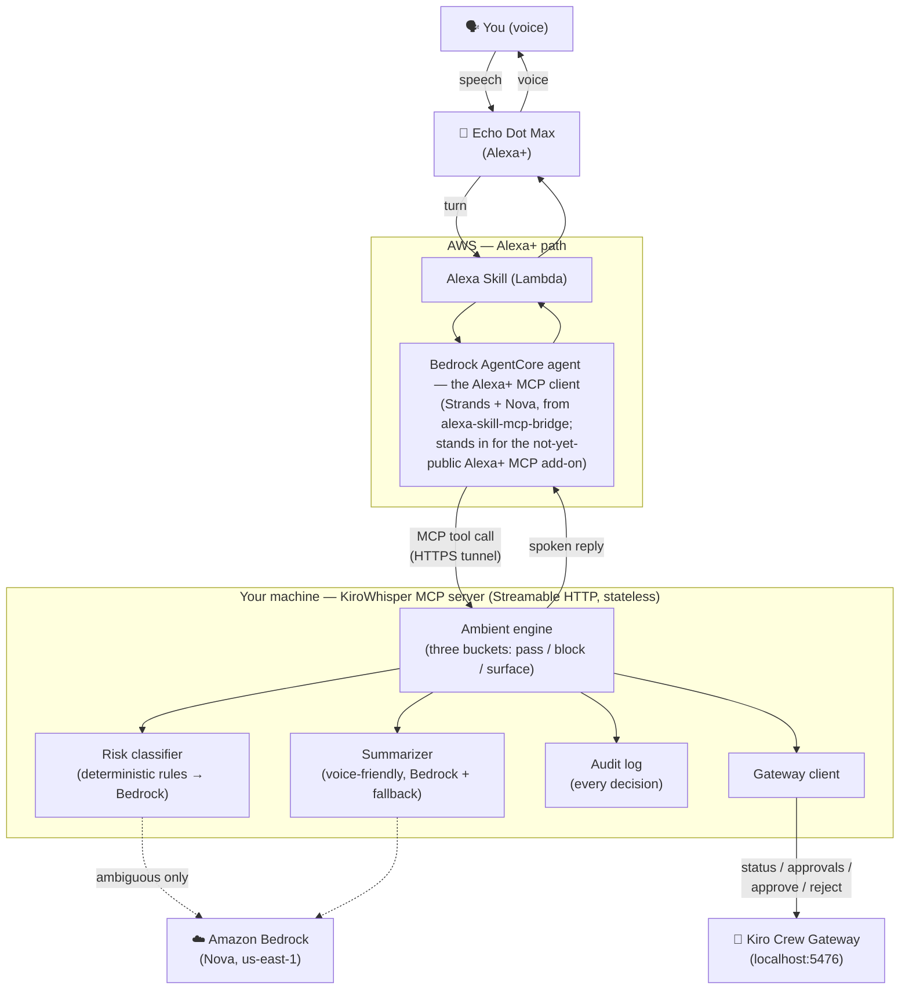

# KiroWhisper

**Voice oversight for autonomous Kiro Crew — hear only the decisions that matter.**

KiroWhisper lets you supervise an autonomous [Kiro Crew](https://github.com/kirodotdev/KiroCrew)
**by voice, through Alexa, without looking at a screen**. Crew works for hours on its
own and pauses at dozens of approval points ("create this file?", "run this
migration?", "delete these lines?"). KiroWhisper watches every one of them, classifies
each by risk, silently handles the safe and the clearly dangerous, and speaks up
**only for the decisions that genuinely need you.**

> **A colleague, not a tool.** Not a command-obeying assistant — a teammate in the
> next room that consults you when it matters and proceeds safely when it doesn't.

Built for the **Amazon "Build, Ship, Shape" Developer Hackathon** — **Alexa+ track**
(self-hosted MCP server), with the **AWS Builder** mini-challenge (Amazon Bedrock,
Bedrock AgentCore, Strands, Kiro Crew).

> **Part of a line of work.** This follows [**KiroCan**](https://marketplace.logi.com/plugin/KiroMxConsole/en),
> my earlier project (live on the Logi Plugin Marketplace) that drives the Kiro **IDE**
> from a physical Logitech MX keypad. KiroCan is hands-on control at your desk;
> KiroWhisper is the next step — **voice control of an autonomous Kiro Crew for when
> you're away from the machine entirely.** IDE-at-your-desk → crew-across-the-room.

> **What runs where.** KiroWhisper is a real, self-hosted **MCP server** (spec
> 2025-11-25, Streamable HTTP) wired to the real Kiro Crew Gateway and Amazon Bedrock.
> The official Alexa+ MCP add-on toolkit is not yet publicly available, so we reach
> Alexa through the open-source
> [`alexa-skill-mcp-bridge`](https://github.com/KayLerch/alexa-skill-mcp-bridge):
> an Alexa Skill hands each spoken turn to an agent on Amazon Bedrock AgentCore, which
> calls our MCP server's tools and speaks the result. The full flow runs on a real Echo
> device and in the Alexa developer console.

---

## For judges — how to evaluate this

KiroWhisper is a **live, single-operator system**, not a hosted web app: it binds one
running Kiro Crew instance (on the maker's machine), a locally served MCP server exposed
through a tunnel, and an Alexa skill + Bedrock AgentCore runtime deployed in the maker's
AWS account, tied to the maker's Amazon account. Cloning the repo alone therefore won't
reproduce a running deployment, and per the hackathon rules judges are not required to
run it. We've made evaluation straightforward:

- **Demo video (primary):** shows the whole flow **functioning on a real Echo Dot Max**
  — discovery, the "while you were away" digest, "which task failed", a context-aware
  session description, and the two-step voice approval actually deleting a file, with the
  Kiro Crew IDE visible so you can see the decision resolve.
- **Code (read it directly):** the MCP server and its
  [13 tools](#mcp-tools-exposed) are in
  [`src/kirowhisper/`](src/kirowhisper/) — `mcp_server.py` (tools), `ambient.py`
  (the three-bucket risk filter), `risk.py`, `policy.py`, `gateway_client.py` (real Kiro
  Crew Gateway calls), `summarizer.py` (Bedrock). The track's tech is **called at
  runtime**, not just named: the tools drive Crew + Bedrock. Run the tests with
  `python -m pytest` (157 passing).
- **What we built on the tools we used:** see [docs/PRODUCT_FEEDBACK.md](docs/PRODUCT_FEEDBACK.md)
  and the [Friction Log](docs/FRICTION_LOG.md) (F1–F24) — a detailed, actionable record
  of every seam we hit across Kiro Crew, Bedrock, the MCP SDK, and Bedrock AgentCore.
- **Want a live look?** We can provide temporary access to the running skill on request
  (the Echo Dot Max is a widely available device, not custom hardware).

See the [Architecture](#architecture) section below for how the pieces connect.

---

## The sharp edge: Ambient Awareness

Voice cannot be scanned like a screen. On a screen you skim 20 approvals in five
seconds; by voice, 20 approvals are 20 interruptions. For a blind developer, that
makes naive "voice approval" unusable. **Ambient Awareness** is the answer:

1. **Silently pass** low-risk, reversible actions (once you trust the session).
2. **Silently block** clearly dangerous ones that match an explicit deny rule.
3. **Surface — by voice — only** what genuinely needs a human decision, highest
   risk first, and read it aloud so you know exactly what you're approving.

This is why accessibility here is a **requirement, not a label**: without the
filter, eyes-free voice oversight simply doesn't work. And it helps everyone away
from the screen — the curb-cut effect.

### What a session sounds like

```
You:    Alexa, open kiro whisper.
Alexa+: Welcome to kirowhisper. Say "get status" or "what needs my decision".
You:    Get status.
Alexa+: One decision is waiting for you, and the crew has four active sessions.
You:    What needs my decision?
Alexa+: The most important one: a shell command that removes a file. This may be
        irreversible. Do you want to approve it or reject it?
You:    Approve it.
Alexa+: This is high-risk. To confirm, are you sure you want to approve this?
You:    Yes.
Alexa+: Approved. The task is continuing.
```

This flow was run live in the Alexa developer console against a real Kiro Crew
(Alexa's wording varies slightly turn to turn) and verified against the backend: the
file was deleted only after the second confirmation.

---

## How the risk filter actually works (defense-in-depth)

We're honest about this: **the classifier is deterministic guardrails first, a model
only for the ambiguous cases** — not "an AI decides everything."

1. **Deterministic rules run first** (`risk.py`). Fast, testable pattern rules flag the
   clearly dangerous — shell commands, `rm -rf`, `DROP TABLE`, force-push, secret/`.env`
   exposure — as HIGH, and clearly reversible read-only ops as LOW. Rules only ever
   *raise* risk; they never downgrade a HIGH.
2. **Amazon Bedrock (Nova) handles only what the rules can't decide.** When the rules
   are inconclusive, the model classifies. On any error or doubt it returns **UNKNOWN**,
   never LOW.
3. **When unsure, surface.** HIGH and UNKNOWN always reach a human. Nothing destructive
   is silently downgraded.

Two safety properties fall out of this, and both are enforced in code and tested:

- **Trust never becomes a hole.** "Trust this session" auto-approves LOW steps — but
  *only rule-certain* LOW (e.g. a verified read-only op). A LOW that the *model merely
  guessed* is still surfaced, even under trust. Security leans on what we know for sure,
  not on a guess. *(Verified live: with trust on, a file-read that Crew did not flag
  read-only was not auto-approved — it still asked.)*
- **Every voice approval needs a second confirmation.** The first "approve" only asks
  "are you sure?"; the decision is applied only on an explicit second confirmation. A
  stray "yes" can never fire a step on its own.

A blacklist of patterns is not a security product — so we don't oversell it. It's a
fast, reliable first layer that fails safe (toward surfacing), backed by the model for
nuance and by a human for anything uncertain.

---

## Architecture



**Data flow.**
- **Ask flow (you → crew):** speech → Echo → Alexa Skill → AgentCore agent → *MCP tool call over the tunnel* → our server reads Crew status/approvals, classifies risk, and speaks a decision back.
- **Approve flow (safety-critical):** "approve it" arms a confirmation (nothing happens); an explicit "yes" on the second call resolves the approval on the Crew Gateway. A single stray word never acts.
- **Filter flow (Ambient Awareness):** each pending approval is classified — rule-certain low-risk is silently passed under trust, catastrophic is silently blocked, everything else is surfaced by voice, highest risk first. Every outcome is written to the audit log.

**Key points.**
- **The intelligence is ours; the voice transport is swappable.** Risk classification, the three-bucket policy, the two-step confirmation, and the spoken wording all live in the MCP server. The Alexa side only turns speech into tool calls and back.
- **Amazon Bedrock** (Nova, `us-east-1`) does nuanced risk classification and voice-friendly summaries. Deterministic rules run first and always win in the safe direction; Bedrock is consulted only when the rules are inconclusive, and returns UNKNOWN on any doubt.
- **Fail-safe by default:** anything uncertain is surfaced to you, never silently approved.
- The server runs **stateless** (each request stands alone), so a long-lived Alexa agent behind a tunnel never hits a dead MCP session.

## How Kiro was used

KiroWhisper was built **entirely within Kiro** using its spec-driven development workflow:

- **Spec-first** — requirements → design → tasks were authored in Kiro before code, and are committed at [`.kiro/specs/kirowhisper/`](.kiro/specs/kirowhisper/) (`requirements.md`, `design.md`, `tasks.md`).
- **Requirements** — user stories with acceptance criteria that map directly to the safety guarantees (three-bucket filter, two-step approval, fail-safe surfacing).
- **Design** — the architecture above, the risk model, and the non-functional requirements (voice-latency budget, secrets masking) were fixed in the design doc first.
- **Implementation** — tasks executed against the specs, each verified by tests; **157 automated tests** map back to the requirements.
- **Kiro Crew** — the autonomous agent this project supervises is itself a Kiro product, driven at runtime through its Gateway.

## Project structure

```
kirowhisper/
├── .kiro/specs/kirowhisper/   # Kiro specs: requirements → design → tasks
├── src/kirowhisper/
│   ├── mcp_server.py          # the 13 MCP tools (the voice surface)
│   ├── ambient.py             # Ambient Awareness: the three-bucket engine
│   ├── risk.py                # deterministic risk rules (+ catastrophic deny)
│   ├── policy.py              # pass / block / surface decision policy
│   ├── summarizer.py          # voice-friendly text (Bedrock + fallback)
│   ├── gateway_client.py      # Kiro Crew Gateway REST client
│   ├── bedrock.py             # Amazon Bedrock (Converse / Nova)
│   ├── audit.py               # append-only decision log + secrets masking
│   └── config.py              # env-driven config (no secrets in source)
├── tests/                     # 157 tests (rules, policy, tools, audit, ...)
├── scripts/                   # dev-only helpers (seed/cleanup test slots)
└── docs/                      # FRICTION_LOG, PRODUCT_FEEDBACK, USE_CASES
```

---

## Quick start

### Prerequisites
- Python 3.12+
- A running [Kiro Crew](https://github.com/kirodotdev/KiroCrew) Gateway on
  `localhost:5476` (the `kirocrew` CLI on your `PATH`, signed in). KiroWhisper fetches a
  fresh token automatically with `kirocrew token` and sends the `Origin` header the
  Gateway requires (equal to its base URL) — no extra setup, as long as the CLI is on
  your `PATH` and signed in. If your Gateway runs elsewhere or uses a different token
  command, override `KIROWHISPER_GATEWAY_URL` / `KIROWHISPER_TOKEN_CMD` (see
  **Configuration** below).
- AWS credentials with Bedrock model access in `us-east-1` (optional for the MCP
  server — a deterministic fallback works without it; required for the Alexa path).

### 1. Run the MCP server

```bash
python -m venv .venv && source .venv/bin/activate
pip install -e ".[dev]"
python -m kirowhisper
# serves the MCP tools over stateless Streamable HTTP on 127.0.0.1:8000/mcp
```

#### MCP tools exposed
`MCP spec 2025-11-25 · Streamable HTTP · 13 tools` — grouped by what the user is
doing; this is the live `tools/list`, printable any time with
`python scripts/show_mcp_tools.py`:

```text
Discover
  help                   spoken "what can you do" menu, for eyes-free use

Check in
  get_status             while-you-were-away digest
  check_task_health      which task failed / how tasks are doing
  describe_session       what a session is working on

Decide
  get_pending_decisions  read the highest-risk decision aloud
  explain_top            why that decision is risky
  approve_top            approve it (two-step confirm)
  reject_top             reject it
  approve_all_safe       clear the rule-certain safe backlog
  trust_session          trust a session going forward
  approve                approve a specific request by id
  reject                 reject a specific request by id

Summarize
  summarize              a task result or diff, voice-friendly
```

The voice path is a two-call flow that works without an elicitation back-channel:
`get_pending_decisions` reads the highest-risk decision aloud, then `approve_top` /
`reject_top` acts on it with no request id. `approve_top` always takes two calls: the
first only asks the user to confirm, the second applies it. Read-only replies end with a
question so the Alexa mic stays open for a natural, multi-turn oversight conversation.

### 2. Expose it to AWS

The AgentCore agent runs in AWS and cannot reach `localhost`, so publish the server
through a tunnel:

```bash
cloudflared tunnel --url http://localhost:8000 --http-host-header localhost:8000
# on networks that block QUIC (UDP 7844), add: --protocol http2
```

Note the `https://<name>.trycloudflare.com` URL it prints. Quick-tunnel URLs change
on every restart.

### 3. Connect Alexa (via `alexa-skill-mcp-bridge`)

Requires Node 22+, Docker (running), the AWS CDK, and the ASK CLI configured with the
**same Amazon account your Echo uses**.

```bash
git clone https://github.com/KayLerch/alexa-skill-mcp-bridge
cd alexa-skill-mcp-bridge && npm install
# in .env:  BRIDGE_MCP_URL=https://<name>.trycloudflare.com/mcp
npm run generate        # builds the interaction model from our live MCP tools
npm run skill:deploy    # deploys the Alexa Skill (interaction model -> Alexa NLU)
npm run deploy          # CDK: AgentCore runtime + skill Lambda (us-east-1)
```

> **Adding or changing a tool needs a cold runtime.** The AgentCore agent snapshots
> the MCP `tools/list` once per warm session and the container can outlive a redeploy,
> so a newly added tool stays invisible until the runtime is recreated. After changing
> tools, run `npm run destroy && npm run deploy` (then `npm run skill:deploy`) so a cold
> container re-lists them. This cost us hours before we understood it — see
> [Friction Log](docs/FRICTION_LOG.md) F17.

KiroWhisper relies on a few changes to the bridge that we made while testing on real
Alexa (see [Friction Log](docs/FRICTION_LOG.md) F11–F15):
- reconnect-and-retry once on a stale MCP session or a changed tool schema;
- system-prompt rules that the agent never approves or rejects without an explicit
  command, and reads a decision aloud before asking;
- sample utterances for "approve it" / "reject it".

Then enable testing in the Alexa developer console (or on your Echo) and say
**"Alexa, open kiro whisper"**, followed by **"what needs my decision"** or
**"get status"**. The explicit "open …" / "ask kiro whisper …" form routes reliably to
the skill.

**Configuration** (all optional, via environment):
`KIROWHISPER_GATEWAY_URL` (default `http://localhost:5476`),
`KIROWHISPER_TOKEN_CMD` (default `kirocrew token`),
`KIROWHISPER_GATEWAY_TOKEN` (an explicit token that overrides the command),
`AWS_REGION`, `KIROWHISPER_AWS_PROFILE`, `KIROWHISPER_BEDROCK_FAST_MODEL`,
`KIROWHISPER_POLL_INTERVAL`.

### Developer tool: web voice console (not the product surface)

`python -m kirowhisper voice` opens a browser console at `http://127.0.0.1:8800` that
talks to the same core services with your own voice (browser speech-to-text, host
text-to-speech). We use it for fast local iteration without deploying to AWS. It is a
**development aid**, not the Alexa experience, and its intent handling is simpler than
the MCP tools'.

---

## How it works with Kiro Crew

KiroWhisper talks to the Crew Gateway's REST API (verified live during a feasibility
spike, see [`spike/`](spike/)):
- `GET /api/status`, `GET /api/approvals` — read state and pending approvals.
- `POST /api/chat/slots/<slot>/approve` — resolve an approval
  (`{"action":"approved"|"rejected"|"trust", "request_id":...}`), then verify the
  approval's real resolved state instead of trusting `{"ok": true}`.

The Ambient engine polls for pending approvals, classifies each, and applies the
three-bucket policy.

---

## Testing

```bash
pytest            # unit tests (no network/model needed)
KIROWHISPER_RUN_INTEGRATION=1 pytest tests/test_gateway_integration.py  # needs a live Gateway
```

The risk classifier, decision policy, trust boundary, two-step confirmation and
fail-safe behavior are covered by a deterministic test suite so the security
guarantees are locked against regression.

---

## Tracks

- **Primary:** Alexa+ — self-hosted MCP server (spec 2025-11-25, Streamable HTTP),
  exercised end to end through an Alexa Skill on a real Echo and the Alexa developer
  console.
- **Mini-challenge:** AWS Builder — Amazon Bedrock (risk classification and spoken
  summaries), Bedrock AgentCore + Strands (the Alexa agent), and Kiro Crew (the
  supervised agent and our development tool).

See also: [Product Feedback](docs/PRODUCT_FEEDBACK.md) ·
[Friction Log](docs/FRICTION_LOG.md) · [Use Cases](docs/USE_CASES.md)

## License

[Apache License 2.0](LICENSE).
